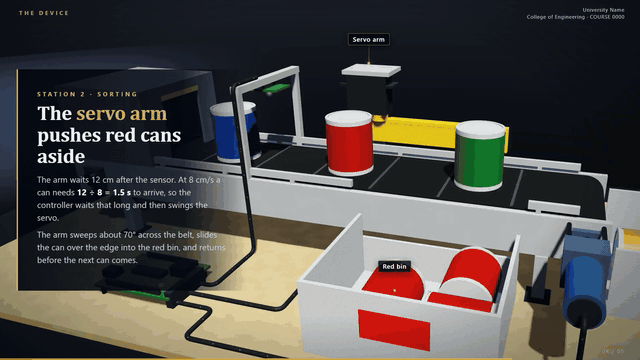
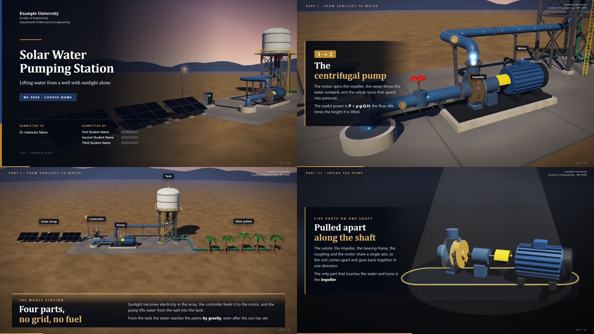

# 3D Presentation Skill: a 3D deck in one HTML file

A Claude Code skill. Ask Claude for a presentation of your project (a device, a machine, a plant, a production line) and it builds **one HTML file that runs offline**. One 3D world stands behind every slide, each slide is a camera on it with a text panel, and "next" is a flight to the next part.



- **One world, built once:** the whole device is one model and the slides are views of it, so the audience sees one continuous journey, not separate pictures.
- **Measured, not eyeballed:** a check computes every pipe and solid against every other, and a tool opens each slide and reports any text off the screen and any callout that is not shown, with the reason.
- **Real parts:** STL files from Fusion or from your print files go into the scene as they are.
- **No libraries:** each example is a single file of about 112 KB with its own engine inside.
- **PowerPoint and video come out of it too:** the same slides as editable text with the scene moving behind them, or the whole deck as a film.

Arabic version: [README.md](README.md)

## Try the two examples

Open the file with a double click; no server, no internet. Arrow keys move between slides, `F` goes full screen.

| Example | What is in it |
|---|---|
| [`example/out/index.html`](example/out/index.html) | A solar water-pumping station: 10 slides, two scenes. A site at dusk where you follow the energy and then the water, and a pump pulled apart along its shaft in the studio |
| [`example-conveyor/out/index.html`](example-conveyor/out/index.html) | A conveyor that sorts cans by colour: 5 slides. Cans travel, and a servo arm pushes the red ones, which tip over the edge and fall into their bin |



**Open them live in the browser:** [both examples](https://sniper797.github.io/3D-Presentation-Skill/) · [the conveyor](https://sniper797.github.io/3D-Presentation-Skill/example-conveyor/out/index.html) · [the pumping station](https://sniper797.github.io/3D-Presentation-Skill/example/out/index.html). The links in the table above show the file's source on GitHub, not the running page.

To rebuild an example and measure it after changing something:

```
pip install websockets pillow
python build.py example
python check.py example --live
```

## What is in the package

| File | What it is |
|---|---|
| `SKILL.md` | The skill itself: the method, the order of work and the checks. Claude reads it |
| `reference.md` | Everything on the stage: scenes, parts, pipes, motion, cameras, materials, slide attributes |
| `engine/` | The renderer (`mini3d.js`, WebGL with no libraries), the stage (`stage.js`), the slide controller and the stylesheet. Shared by every deck |
| `example/`, `example-conveyor/` | Two complete decks: `scene.js` and `slides.html`, with the built file in `out/` |
| `build.py` | Deck folder → one HTML file |
| `check.py` | Opens every slide in headless Chrome on the real GPU: clashes, text, callouts, frame time, and a picture of each slide. `--at` photographs chosen moments of the motion |
| `stl2models.py` | Packs STL files for the scene to read |
| `to-powerpoint.md`, `pptx/` | The same deck as a PowerPoint file, still or with motion, and as a film of the whole deck |
| `index.html` | The page of the two examples on GitHub Pages. Not part of the skill |
| `recipes/` | An index of realistic parts (turbine, pump, boiler, pylons) from a steam power plant scene. The scene itself is not published here; see "Where it came from" |

## Install

You need [Claude Code](https://claude.com/claude-code), Python 3 with `websockets` and `pillow`, and Chrome.

```
git clone https://github.com/Sniper797/3D-Presentation-Skill.git ~/.claude/skills/building-3d-html-presentations
```

On Windows the folder is `%USERPROFILE%\.claude\skills\building-3d-html-presentations`. Claude Code finds the skill by itself in the next session.

**For the PowerPoint and video route only:** Node 22 with `npm install` inside `pptx/`, `ffmpeg`, Windows with PowerPoint, and Anthropic's `pptx` skill (the script borrows its theme writer).

**Updating:** `git pull` inside the folder.

## Use

Open Claude Code in your project folder and ask in plain words, for example: "make a short 3D HTML deck for the conveyor project, five slides" or "build a presentation of the pumping station, the STL files are in parts". The skill starts on its own and goes through these stages:

1. **Story before geometry:** what travels (water, energy, a product), which stations it passes, and one sentence for each.
2. **The world:** every position and size is a named constant, static parts are merged, moving parts are their own nodes, and every pipe and large body is registered for the check.
3. **Motion:** pulses that run through the pipes, a drop that follows the route the slide is about, solid parts that travel. All of it returns exactly to its start, so it records as a video with no jump.
4. **Slides:** a short heading and two paragraphs of complete sentences, with the panel on the side away from the subject.
5. **Checks:** zero clashes, no text off the screen, every callout shown, then a look at the picture of every slide.
6. **Delivery:** the file, what was measured, and what nobody has watched.

## Measured, and not yet tried

| Measured | Result |
|---|---|
| Clashes in the two examples | 0 of 378 pairs, and 0 of 171 |
| Frame time at 1920×1080 on an RTX 4060 | 1.0 to 6.7 ms |
| Repeat of the motion in recorded clips | a difference of 0.000 to 0.001 at the seam, against 0.4 to 1.7 between two consecutive frames |
| Arabic, right to left, in HTML | letters stay joined; the counter, formulas and percentages keep their direction |
| A new reader | an agent that had never seen the skill built the conveyor example from it, and the gaps it found were closed |

Not yet tried:

- Anything but Windows and Chrome. The browser path in the scripts is Chrome's path on Windows.
- An Arabic deck through the PowerPoint route.
- The clash check does not see moving parts: their positions are derived from geometry and reviewed in `--at` pictures.
- A live run in front of an audience on a projector.

## Where it came from

This skill grew out of a collaboration between **Ahmed Saif** and Mohammad Ghassan. Ahmed made the original presentation for his team's steam power plant project; Mohammad took it and improved it with Ahmed's own prompt. The format, the look and the first version of the engine come from that presentation: one world, with the camera flying between its parts. This skill then turned that way of presenting into a general method for any project, and added the measuring. The plant scene itself is the team's work, so it is not in this repository.

## License

Copyright (c) 2026 Mohammad Ghassan. Released under the [PolyForm Strict License 1.0.0](LICENSE.md):

- **Allowed:** downloading and using it for learning, experiments and personal projects, and at universities and non-profit organizations.
- **The deck you build is yours:** your scene, slides and text belong to you, and you may send, publish and present the built file to anyone, with the engine embedded in it. Whoever receives it may open it and show it. This is an additional permission, written at the top of [LICENSE.md](LICENSE.md).
- **Not allowed without written permission:** changing it, building other tools on it, taking the engine out of a built deck to use it on its own, redistributing or passing it on, or commercial use. Anyone who wants it should download it from here.

For permission or collaboration, reach out on [GitHub](https://github.com/Sniper797).

---

**العربيّة:** الدليل كاملاً بالعربيّة في [README.md](README.md).
