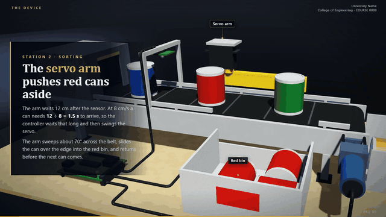
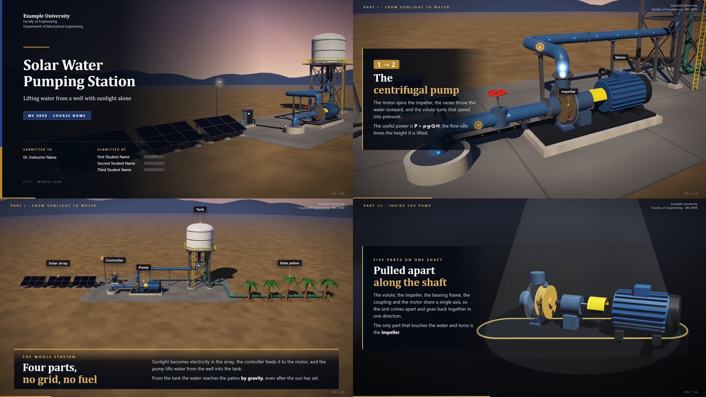

# 3D Presentation Skill — عرضٌ ثلاثيّ الأبعاد في ملفّ HTML واحد

مهارةٌ لـ Claude Code: حين تطلب منه عرضاً لمشروعك (جهاز، آلة، محطّة، خطّ إنتاج)، يبني لك **ملفّ HTML واحداً يعمل بلا إنترنت**. خلف الشرائح كلّها عالَمٌ ثلاثيّ الأبعاد واحد، وكلّ شريحةٍ كاميرا عليه مع لوحة نصّ، و«التالي» طيرانٌ إلى القطعة التالية.



- **عالَمٌ واحد يُبنى مرّةً واحدة:** الجهاز كلّه مجسّمٌ واحد، والشرائح مناظر عليه، فيرى الجمهور رحلةً متّصلة لا صوراً متفرّقة.
- **يُقاس ولا يُقدَّر بالعين:** فحصٌ يحسب تداخل كلّ أنبوبٍ وجسمٍ مع غيره، وأداةٌ تفتح كلّ شريحة وتقول أيّ نصٍّ خرج عن الشاشة وأيّ بطاقةٍ لم تظهر ولماذا.
- **قطعٌ حقيقيّة:** ملفّات STL من Fusion أو من ملفّات الطباعة تدخل المشهد كما هي.
- **بلا مكتبات:** كلّ مثالٍ ملفٌّ واحد حجمه نحو 112 KB، فيه محرّكه.
- **ويخرج منه PowerPoint وفيديو:** الشرائح نفسها نصوصاً قابلةً للتعديل والمشهد يتحرّك خلفها، أو فيلمٌ للعرض كاملاً.

النسخة الإنجليزيّة: [README.en.md](README.en.md)

## جرّب المثالين

افتح الملفّ بنقرتين، بلا خادمٍ ولا إنترنت. تنقّل بالسهمين، و`F` لملء الشاشة.

| المثال | ما فيه |
|---|---|
| [`example/out/index.html`](example/out/index.html) | محطّة ضخّ ماء بالطاقة الشمسيّة: 10 شرائح ومشهدان. موقعٌ عند الغروب تتبع فيه الطاقة ثمّ الماء، ومضخّةٌ تتفكّك على طول عمودها في الاستوديو |
| [`example-conveyor/out/index.html`](example-conveyor/out/index.html) | سيرٌ ناقل يفرز العلب حسب اللون: 5 شرائح. علبٌ تسير، وذراع سيرفو تدفع الحمراء فتميل على الحافّة وتسقط في صندوقها |



**افتحهما حيَّين من المتصفّح:** [صفحة المثالين](https://sniper797.github.io/3D-Presentation-Skill/) · [السير الناقل](https://sniper797.github.io/3D-Presentation-Skill/example-conveyor/out/index.html) · [محطّة الضخّ](https://sniper797.github.io/3D-Presentation-Skill/example/out/index.html). روابط الجدول أعلاه تعرض مصدر الملفّ على GitHub لا الصفحة نفسها.

ولإعادة بناء مثالٍ وقياسه بعد أن تعدّل فيه:

```
pip install websockets pillow
python build.py example
python check.py example --live
```

## ما في الحزمة

| الملفّ | ما هو |
|---|---|
| `SKILL.md` | المهارة نفسها: الطريقة وترتيب العمل والفحوص، يقرؤها Claude |
| `reference.md` | كلّ ما في المسرح: المشاهد، القطع، الأنابيب، الحركة، الكاميرات، الخامات، خصائص الشرائح |
| `engine/` | المحرّك (`mini3d.js`، WebGL بلا مكتبات)، والمسرح (`stage.js`)، ومتحكّم الشرائح، وتنسيق العرض. مشتركةٌ بين كلّ العروض |
| `example/`، `example-conveyor/` | مثالان كاملان: `scene.js` و`slides.html`، والملفّ المبنيّ في `out/` |
| `build.py` | مجلّد العرض ← ملفّ HTML واحد |
| `check.py` | يفتح كلّ شريحة في Chrome بلا واجهة على كرت الشاشة: التداخل، النصوص، البطاقات، زمن الإطار، وصورةٌ لكلّ شريحة. و`--at` يصوّر لحظاتٍ مختارة من الحركة |
| `stl2models.py` | يحزم ملفّات STL ليقرأها المشهد |
| `to-powerpoint.md`، `pptx/` | العرض نفسه ملفَّ PowerPoint، ثابتاً أو بحركة، وفيلماً للعرض كاملاً |
| `index.html` | صفحة المثالين على GitHub Pages. ليست جزءاً من المهارة |
| `recipes/` | فهرس قطعٍ واقعيّة (توربين، مضخّة، غلاية، أبراج) من مشهد محطّةٍ بخاريّة. المشهد نفسه غير منشور هنا، انظر «من أين جاءت» |

## التثبيت

تحتاج [Claude Code](https://claude.com/claude-code)، وPython 3 مع `websockets` و`pillow`، وChrome.

```
git clone https://github.com/Sniper797/3D-Presentation-Skill.git ~/.claude/skills/building-3d-html-presentations
```

على Windows يصير المجلّد `%USERPROFILE%\.claude\skills\building-3d-html-presentations`. يجد Claude Code المهارة وحده في الجلسة التالية.

**لمسار PowerPoint والفيديو فقط:** Node 22 مع `npm install` داخل `pptx/`، و`ffmpeg`، وWindows عليه PowerPoint، ومهارة `pptx` من Anthropic (يأخذ منها السكربت كتابة الثيم).

**التحديث:** `git pull` داخل المجلّد.

## الاستعمال

افتح Claude Code في مجلّد مشروعك، واطلب بالكلام، مثل: «سوّ لي عرض HTML ثلاثيّ الأبعاد لمشروع السير الناقل، خمس شرائح» أو «اعمل عرضاً لمحطّة الضخّ ومعه ملفّات STL في مجلّد parts». تبدأ المهارة وحدها، وتمرّ بهذه المراحل:

1. **القصّة قبل الهندسة:** ما الذي يسافر (ماء، طاقة، منتَج)، وأيّ المحطّات يمرّ بها، وجملةٌ لكلّ محطّة.
2. **العالَم:** كلّ موضعٍ ومقاسٍ ثابتٌ مسمّى، والقطع الثابتة تُدمج، والمتحرّكة عُقدٌ مستقلّة، وكلّ أنبوبٍ وجسمٍ كبير يُسجَّل للفحص.
3. **الحركة:** نبضاتٌ تسير في الأنابيب، وقطرةٌ تتبع المسار الذي تحكيه الشريحة، وأجسامٌ صلبة تسافر، وكلّها تعود إلى بدايتها بالضبط فتُسجَّل فيديو بلا قفزة.
4. **الشرائح:** عنوانٌ قصير وفقرتان من جملٍ تامّة، واللوحة في الجهة البعيدة عن القطعة.
5. **الفحوص:** التداخل صفر، ولا نصّ خارج الشاشة، وكلّ بطاقةٍ ظاهرة، ثمّ نظرةٌ في صورة كلّ شريحة.
6. **التسليم:** الملفّ، وما قِيس، وما لم يشاهده أحد.

## ما قِيس وما لم يُجرَّب

| ما قِيس | النتيجة |
|---|---|
| التداخل في المثالين | 0 من 378 زوجاً، و0 من 171 |
| زمن الإطار عند 1920×1080 على RTX 4060 | 1.0 إلى 6.7 ms |
| تكرار الحركة في المقاطع المسجَّلة | فرق 0.000 إلى 0.001 عند نقطة التكرار، مقابل 0.4 إلى 1.7 بين إطارين متتاليين |
| العربيّة من اليمين إلى اليسار في HTML | الحروف متّصلة، والعدّاد والمعادلات والنِّسب باتّجاهها |
| قارئٌ جديد | وكيلٌ لا يعرف المهارة بنى منها مثال السير الناقل، وسُدّت الثغرات التي كشفها |

ولم يُجرَّب بعد:

- غير Windows وChrome. مسار المتصفّح في السكربتات هو مسار Chrome على Windows.
- عرضٌ عربيّ عبر مسار PowerPoint.
- فحص التداخل لا يرى الأجسام المتحرّكة: تُشتقّ مواضعها من الهندسة وتُراجَع في صور `--at`.
- عرضٌ حيّ أمام جمهور على جهاز عرض.

## من أين جاءت

هذه المهارة ثمرة تعاونٍ بين **أحمد سيف** ومحمد غسان. صنع أحمد العرض الأصليّ لمشروع فريقه عن محطّة قدرة بخاريّة، ثمّ أخذه محمد وحسّنه ببرومبت أحمد نفسه. ومن ذلك العرض جاءت الصيغة والمظهر والنسخة الأولى من المحرّك: عالَمٌ واحد تطير الكاميرا بين أجزائه. ثمّ عمّمت هذه المهارة تلك الطريقة لأيّ مشروع، وأضافت القياس. ومشهد المحطّة نفسه عملُ الفريق، فليس في هذا المستودع.

## الرخصة

حقوقه محفوظة لمحمد غسان، ويُنشر برخصة [PolyForm Strict 1.0.0](LICENSE.md):

- **مسموح:** تنزيله واستعماله في التعلّم والتجربة والمشاريع الشخصيّة، وفي الجامعات والجهات غير الربحيّة.
- **والعرض الذي تبنيه به لك:** مشهدك وشرائحك ونصوصك ملكك، ولك أن ترسل الملفّ المبنيّ وتنشره وتعرضه على من تشاء والمحرّك مضمَّنٌ فيه، ولمن وصله أن يفتحه ويعرضه. هذا إذنٌ إضافيّ مكتوب في أوّل [LICENSE.md](LICENSE.md).
- **ممنوع دون إذنٍ مكتوب:** تعديله، أو بناء أداةٍ عليه، أو إخراج المحرّك من عرضٍ مبنيّ لاستعماله وحده، أو إعادة نشره أو إرساله لغيرك، أو استعماله تجاريّاً. من أراده فلينزّله من هنا.

للإذن أو للتعاون: تواصل عبر [GitHub](https://github.com/Sniper797).

---

**English:** the full guide in English is in [README.en.md](README.en.md).
